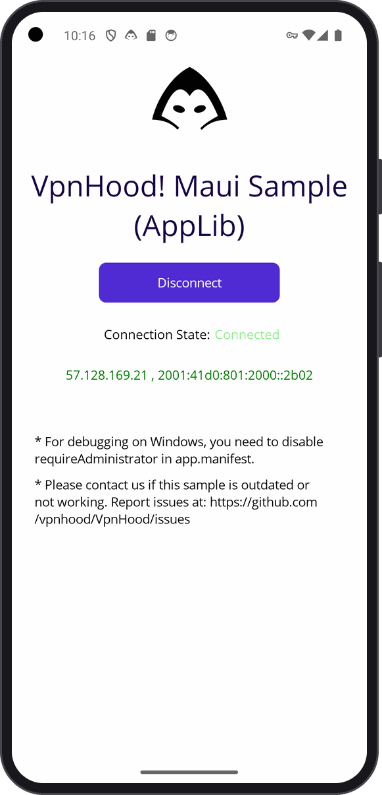

# AppLibSample.MauiForm

The whole VpnHood app, its logic without its UI, under a MAUI page of your own: `VpnHood.AppUi.Hosting.Maui` runs the
app in the same process, and the page talks to it through the app's API, the calls every VpnHood UI makes. The app
brings what a VPN app needs beyond the engine: reconnection, access keys, split tunneling, notifications, and ads and
billing when you set them up.

**Who it is for:** you want a complete VPN app under screens of your own, without writing what a VPN app does beyond
connecting.

## What you need

- An Android phone or emulator, or Windows.
- The .NET SDK the project targets, with the `maui-android` workload, and `maui-windows` for Windows.
- On Windows, administrator rights, which [Platforms/Windows/app.manifest](Platforms/Windows/app.manifest) asks for.

## Run it

Open the project in Visual Studio and run it on an Android emulator or device, or on Windows Machine. The first
Connect on Android asks to show notifications, then brings Android's connection request: OK lets the app make a VPN.

## Read first

- [MauiProgram.cs](MauiProgram.cs): `CreateInitParams`, who the app is and its options, with the sample server's access
  key (`ClientOptions.SampleAccessKey`), which `VpnHoodAppMaui.Init` starts.
- [MainPage.xaml.cs](MainPage.xaml.cs): the page reads the app's state through `VpnHoodAppMaui.Instance.Api` once a
  second, and connects and disconnects through it.

For a complete app with VpnHood's own UI, start from
[VpnHood.App.Template](https://github.com/vpnhood/VpnHood.App.Template).
