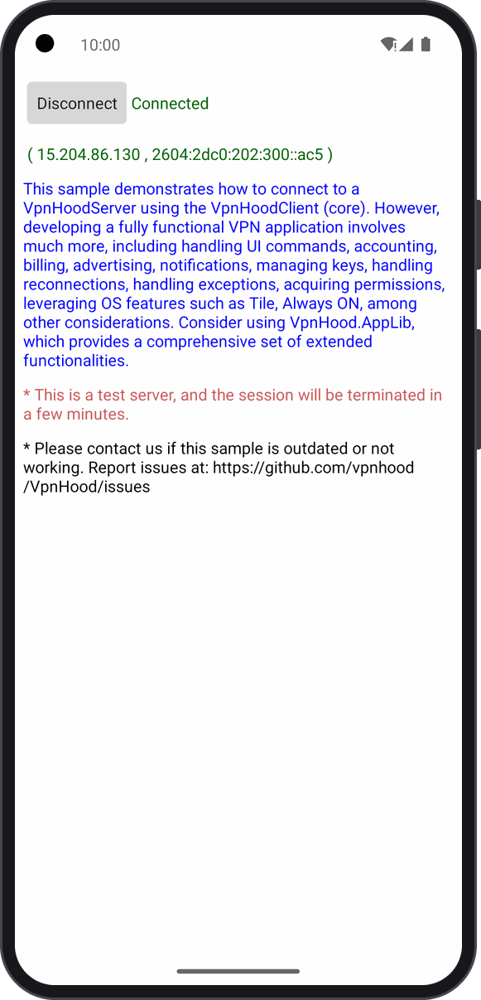

# CoreSample.AndroidForm

The VPN engine alone on Android, in a plain activity: Connect starts the VPN service through `VpnServiceManager`, the
engine in it connects to VpnHood's test server, and the page shows the connection's state and your public IP
addresses, the server's once connected.

**Who it is for:** you write an Android app in .NET for Android, without MAUI, with screens of your own, and handle
access keys, reconnection and the rest yourself.



## What you need

- An Android phone or emulator.
- The .NET SDK the project targets, with the `android` workload.

## Run it

In this folder, with the phone or emulator connected:

```powershell
dotnet build -t:Run
```

The first Connect brings Android's connection request: OK lets the app make a VPN.

## Read first

[MainActivity.cs](MainActivity.cs): `ConnectTask` starts the service with the client's options (`VpnServiceOptions`,
with the test server's access key, `ClientOptions.SampleAccessKey`), `UpdateUi` follows
`VpnServiceManager.StateChanged`, and `OnResume` hands the activity to the engine (`AppUiContext.Context`), so it can ask
for the VPN permission.

A whole VPN app needs much more: reconnection, keys, notifications, ads, billing. For that, see
[AppLibSample.MauiForm](../AppLibSample.MauiForm), or start from
[VpnHood.App.Template](https://github.com/vpnhood/VpnHood.App.Template).
