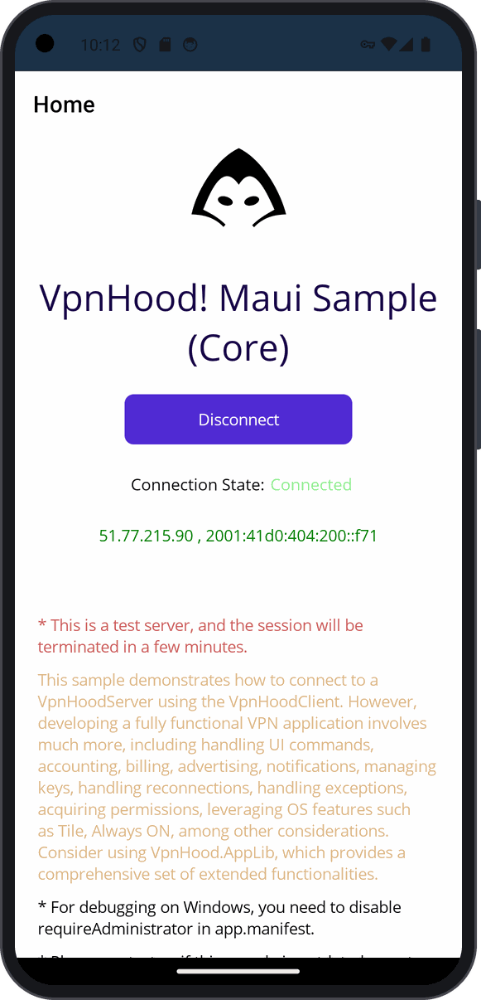

# CoreSample.MauiForm

The VPN engine alone in a MAUI app, on Android and Windows: one page whose Connect starts the VPN service through
`VpnServiceManager`, connected to VpnHood's test server, with the connection's state and your public IP addresses,
the server's once connected.

**Who it is for:** you write a MAUI app and want the VPN in it on Android and Windows, with screens of your own, and
handle access keys, reconnection and the rest yourself.

## What you need

- An Android phone or emulator, or Windows.
- The .NET SDK the project targets, with the `maui-android` workload, and `maui-windows` for Windows.
- On Windows, administrator rights, which [Platforms/Windows/app.manifest](Platforms/Windows/app.manifest) asks for: the
  WinTun adapter adds a network interface.

## Run it

Open the project in Visual Studio and run it on an Android emulator or device, or on Windows Machine. The first
Connect on Android brings its connection request: OK lets the app make a VPN.

## Read first

- [MauiProgram.cs](MauiProgram.cs): the `VpnServiceManager` over the platform's device.
- [Platforms/Android/MainApplication.cs](Platforms/Android/MainApplication.cs) and
  [Platforms/Windows/App.xaml.cs](Platforms/Windows/App.xaml.cs): the device each platform gives it, `AndroidDevice`
  or `WindowsDevice`.
- [MainPage.xaml.cs](MainPage.xaml.cs): Connect and Disconnect, and the state on the page.

A whole VPN app needs much more: reconnection, keys, notifications, ads, billing. For that, see
[AppLibSample.MauiForm](../AppLibSample.MauiForm), or start from
[VpnHood.App.Template](https://github.com/vpnhood/VpnHood.App.Template).
