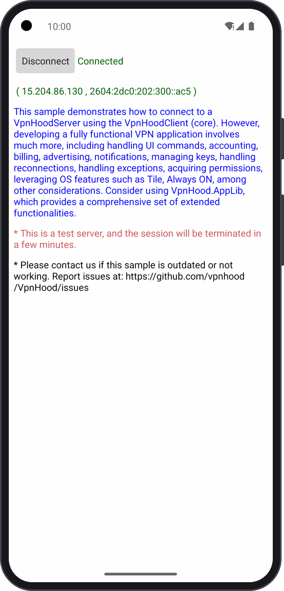
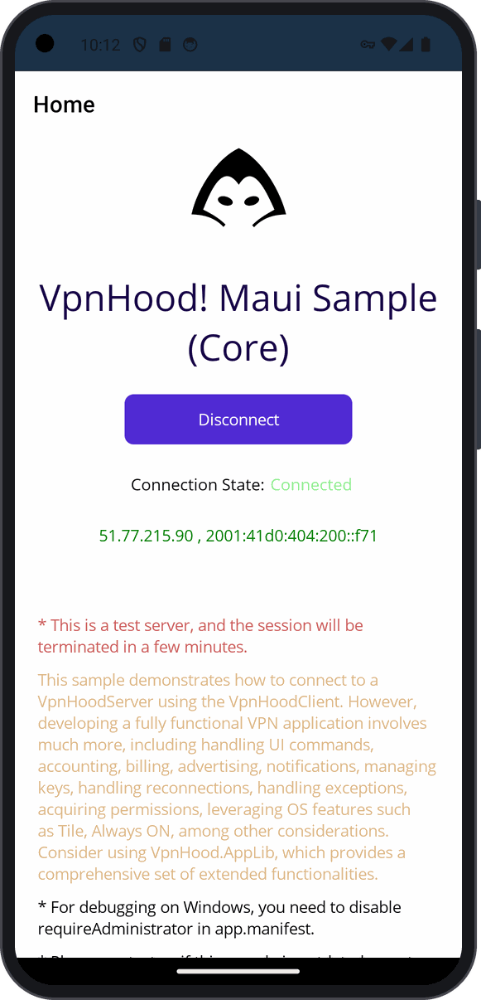
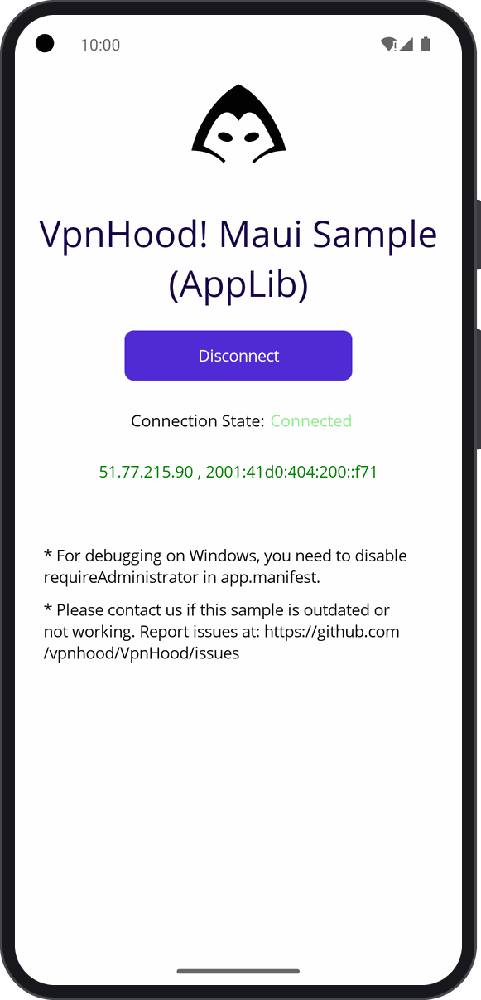

# VpnHood.App.Samples

Small apps that show VpnHood at work, each built on VpnHood's NuGet packages alone, as an app of yours would be: VPN
clients that write more or less of the app themselves, and a VPN server of your own. The clients connect to VpnHood's
test server, which ends each session after a few minutes. Each sample's folder has a README with
what it needs, how to run it and which file to read first.

## Which one to read

| You want to | Read |
| --- | --- |
| Put the VPN into a Windows program or service of your own, with no UI | [CoreSample.WinConsole](CoreSample.WinConsole) |
| Add the VPN to an Android app of your own, without MAUI | [CoreSample.AndroidForm](CoreSample.AndroidForm) |
| Add the VPN to a MAUI app, on Android and Windows | [CoreSample.MauiForm](CoreSample.MauiForm) |
| Have a complete VPN app under screens of your own | [AppLibSample.MauiForm](AppLibSample.MauiForm) |
| Run a VPN server from a .NET program of your own | [CoreSample.Server](CoreSample.Server) |
| Have the whole app, VpnHood's own screens too | Not a sample: start from [VpnHood.App.Template](https://github.com/vpnhood/VpnHood.App.Template) |

## The VPN engine alone

You write the app around the engine: its screens, and everything a VPN app does beyond connecting, such as keeping
access keys and reconnecting. The guide: [Use the VPN engine in your own app](https://developer.vpnhood.com/articles/use-the-engine.html).

- **[CoreSample.WinConsole](CoreSample.WinConsole):** `VpnHoodClient` over a WinTun adapter, in a console on Windows,
  with no UI. Run it as an administrator.
- **[CoreSample.AndroidForm](CoreSample.AndroidForm):** in a plain Android activity, through the VPN service
  (`VpnServiceManager`), with the connection's state and the public IP on one page.
- **[CoreSample.MauiForm](CoreSample.MauiForm):** the same in a MAUI app, on Android and Windows, each platform giving
  the engine its device.

## The app's logic, under your own screens

The app is ready, with reconnection, access keys, split tunneling and notifications, and only its screens are yours.
The guide: [Your own screens over the app's logic](https://developer.vpnhood.com/articles/use-the-app-logic.html).

- **[AppLibSample.MauiForm](AppLibSample.MauiForm):** a MAUI page of its own over the app
  (`VpnHood.AppUi.Hosting.Maui`), which talks to it through the app's API, the calls every VpnHood UI makes.

## A server of your own

The guide: [Run a VPN server from your own code](https://developer.vpnhood.com/articles/run-a-server.html).

- **[CoreSample.Server](CoreSample.Server):** `VpnHoodServer` in a console app, its access keys kept in files: it
  prints one and serves clients until Ctrl+C. With `--tun`, it serves through the platform's TUN adapter.

## Run them

Clone this repository and open `VpnHood.App.Samples.slnx` in Visual Studio, or run a sample with `dotnet run` in its
folder. They need the .NET SDK the projects target, and its workloads for the platforms they run on: `android` and
`maui-android` for Android, `maui-windows` for MAUI on Windows.

The samples build against the VpnHood packages whose version `Directory.Build.props` pins. A local version
(`-localN`) comes from a `.packages` folder beside that file, which git ignores; a clean clone restores only a
published one.

A sample that is out of date or does not work: tell us at [VpnHood's issues](https://github.com/vpnhood/VpnHood/issues).
